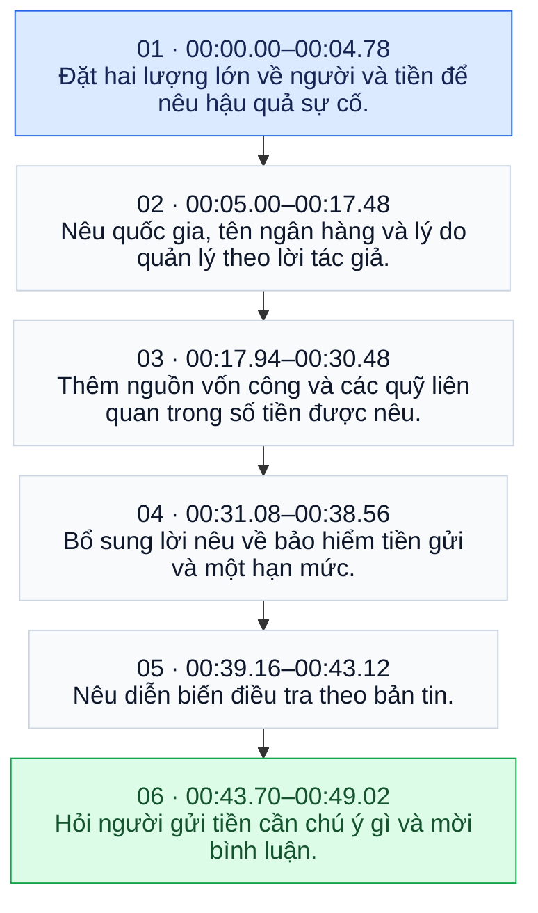

# Tiền gửi bị gián đoạn: headline lớn và phần điều kiện phía sau

[Video gốc — @d.trending](https://www.tiktok.com/@d.trending/video/7704887346113580308) · ID `7704887346113580308`

**Tóm tắt cách kể:** Tác động lớn được nêu trước → bổ sung bối cảnh và nhóm liên quan → thêm điều kiện giảm tính tuyệt đối → hỏi cách ứng xử.

[Sơ đồ diễn biến](#mindmap) · [Diễn biến](#dien-bien) · [Nhịp cảm xúc](#cam-xuc) · [Cách áp dụng](#ap-dung)

## Sơ đồ diễn biến

Đọc từ trên xuống: mỗi hộp là một nhịp theo mốc ASR hoặc khung hình được ghi trong phân tích. Xanh dương là mở đầu, xanh lá là nhịp cuối. Chi tiết và giới hạn nằm trong phân tích bên dưới.

[Mã Mermaid riêng](../mindmaps/7704887346113580308.mmd)

## Dữ liệu và nguồn

**Cách thể hiện:** Bản tin ngắn trên footage

**Ngữ cảnh thương mại:** Chưa xác nhận hợp tác thương mại; xem các đoạn tự quảng bá/giới hạn được ghi riêng.

- Đăng: 2026-11-06T08:00:00+00:00. Metadata lấy: 2026-11-15T04:04:07.402034+00:00.
- **157,000 view**; thích 2,214; bình luận 85; chia sẻ 1,056; lưu 217. Dấu phẩy tách hàng nghìn.
- Thời lượng media: 49.43s.
- **66.67× P50** 2,355 của 124 bài đủ 48h trong snapshot kênh. Clip có trong cửa sổ baseline. Không phải thống kê toàn bộ kênh.

## Phạm vi kiểm

Đã tải media, xem khung chọn lọc và đọc ASR có mốc lưu lúc 2026-11-15T04:06:29.607293+00:00. Đối chiếu cùng ID và thời lượng, lệch 0.003s. **Chưa nghe toàn âm hoặc xem chuyển động liên tục; chưa xác nhận toàn văn ASR hay mọi dữ kiện kinh tế trong clip.**

Media SHA256: `51727356fbeb25abac0e237eab67626381bd5b532c76626f416a7075dd6bd17c`. [Metadata và các hash khác](../videos.json). Video/ASR đầy đủ giữ ở bộ nghiên cứu cục bộ; bản chia sẻ giữ link gốc, trích ngắn và phân tích riêng.

## Lời hứa và câu hỏi trung tâm

**Lời hứa:** Một sự cố tiền gửi có quy mô lớn sẽ được giải thích về bối cảnh và tác động.

**Câu hỏi:** Sự gián đoạn ảnh hưởng tới ai và điều kiện bảo vệ nào thay đổi cách hiểu headline?

## Mở đầu: lời và hình

Câu đầu đặt số người bị ảnh hưởng cạnh số tiền bị mắc kẹt. Hình 0–3s là đám đông ngoài phố, headline vàng giữ thông tin sự cố. Mở nhấn hậu quả trước khi cho biết bối cảnh nước ngoài và phạm vi bảo vệ tiền gửi.

> 3 triệu khách hàng không thể rút tiền, hơn 21.800 tỷ đồng tại một ngân hàng bị mắc kẹt.

Trích ASR ngắn từ segment 00:00.00–00:04.78. Trích ASR chưa nghe đối chiếu; dữ kiện thuộc lời người đăng, chưa xác thực. Xem giới hạn từng ca. Dấu … nghĩa là bỏ bớt, không khẳng định toàn câu vừa ba giây.

| Mốc khung đã xem | Điều quan sát được |
|---|---|
| 00:00.00 | Footage đám đông có cờ, phía dưới có caption tiếng Anh và headline tiếng Việt về tiền không rút được. |
| 00:14.83 | Hình tòa nhà/cảnh lực lượng bên ngoài; headline sự cố vẫn giữ. |
| 00:22.24 | Một biển ngân hàng đứng dọc bên ngoài tòa nhà. |
| 00:44.49 | Footage biển biểu tình ở cuối, trong khi headline vẫn không bổ sung chi tiết bảo vệ tiền gửi. |

Không suy chuyển động giữa các khung từ ảnh tĩnh.

## Diễn biến và nhiệm vụ từng beat

| Mốc ASR | Diễn giải riêng | Vai trò |
|---|---|---|
| 00:00.00–00:04.78 | Đặt hai lượng lớn về người và tiền để nêu hậu quả sự cố. | Mở bằng tác động và quy mô. |
| 00:05.00–00:17.48 | Nêu quốc gia, tên ngân hàng và lý do quản lý theo lời tác giả. | Đặt bối cảnh cho headline. |
| 00:17.94–00:30.48 | Thêm nguồn vốn công và các quỹ liên quan trong số tiền được nêu. | Mở rộng nhóm chịu tác động. |
| 00:31.08–00:38.56 | Bổ sung lời nêu về bảo hiểm tiền gửi và một hạn mức. | Điều kiện làm cảm giác rủi ro ở đầu bớt tuyệt đối. |
| 00:39.16–00:43.12 | Nêu diễn biến điều tra theo bản tin. | Thêm nhánh trách nhiệm, chưa là kết luận xác minh của kho. |
| 00:43.70–00:49.02 | Hỏi người gửi tiền cần chú ý gì và mời bình luận. | Kết thành lời mời tương tác, không trả một bảng kiểm hoàn chỉnh. |

## Nhịp cảm xúc — giả thuyết biên tập

Các trạng thái dưới đây là cách đọc câu chuyện từ bằng chứng, không phải cảm xúc người xem đã đo hoặc biểu đồ retention.

| Mốc | Cảm xúc có thể gợi | Bằng chứng | Cách diễn giải |
|---|---|---|---|
| 00:00.00–00:04.78 | Báo động | Hai lượng người và tiền lớn được đặt cạnh việc không rút được. | Có thể kéo sự chú ý vì hậu quả sát tài sản, nhưng không có dữ liệu đo cảm xúc. |
| 00:05.00–00:17.48 | Tìm nguyên nhân | Bổ sung quốc gia và lời giải thích việc quản lý ngân hàng. | Người xem có bối cảnh để không nhầm đây là sự việc trong nước. |
| 00:17.94–00:30.48 | Thấy phạm vi lan rộng | Nêu vốn công và các quỹ. | Thêm lớp tác động, không chứng minh chi tiết đó đã đúng. |
| 00:31.08–00:38.56 | Điều chỉnh mức lo | Bổ sung bảo vệ và hạn mức theo tác giả. | Một điều kiện quan trọng làm lời mở không thể đọc theo nghĩa mất toàn bộ. |
| 00:43.70–00:49.02 | Chuyển sang tự liên hệ | Hỏi người gửi tiền cần chú ý. | Tạo chỗ thảo luận, chưa đưa bước kiểm đầy đủ. |

## Cách phân phối thông tin

| Mốc | Động tác viết | Vì sao đáng chú ý |
|---|---|---|
| 00:00.00–00:04.78 | Đưa quy mô trước tên sự kiện. | Tập trung hậu quả ngay mở. |
| 00:05.00–00:17.48 | Bổ sung bối cảnh nước ngoài và nguyên nhân được báo cáo. | Giới hạn đối tượng headline. |
| 00:17.94–00:30.48 | Phân nhỏ số tiền thành nguồn liên quan. | Làm quy mô có thành phần thay vì một số trừu tượng. |
| 00:31.08–00:38.56 | Đưa điều kiện bảo vệ sau phần gây lo. | Có tác dụng đổi cách hiểu; nếu chậm quá có thể khiến phần mở gây hiểu sai. |
| 00:43.70–00:49.02 | Đổi bản tin thành câu hỏi cho người xem. | Mời liên hệ, nhưng chưa thay được phần hướng dẫn có nguồn. |

## Giải đáp và cách kết

Phần giữa có điều kiện bảo vệ người gửi tiền, nhưng cuối chỉ hỏi và kêu gọi bình luận. Cần giữ cả điều kiện đó khi học mở đầu; không bê riêng con số gây lo lắng thành một cảnh báo mới.

## Điểm mạnh có dẫn chứng

- **Headline dễ nhận diện** — 0–4,78s có hành động bị gián đoạn và hai lượng cụ thể.

- **Có chi tiết hạn chế kết luận tuyệt đối** — 31,08–38,56s thêm bảo vệ tiền gửi thay vì giữ toàn bài ở trạng thái hoảng.

## Điểm yếu và điều không nên bắt chước

- **Điều kiện quan trọng đến khá muộn** — Tới 31,08s mới có phần bảo vệ; chữ headline vẫn là lời báo động ở khung cuối.

- **Hình minh họa chưa chứng minh nguồn sự kiện** — Đám đông, tòa nhà và biển ngân hàng không đủ xác nhận mọi phát biểu ASR.

- **Kết hỏi thay vì trả đầy đủ** — 43,7–49,02s là câu hỏi và CTA bình luận.

## Khả năng được chia sẻ — chưa kiểm chứng

Không có dữ liệu phân phối/retention để kết luận vì sao viral. Các ý sau chỉ là giả thuyết để thử:

- Tác động tiền gửi có thể khiến người xem gửi tin cho người thân; chưa có số liệu cho giả thuyết đó.

- Hai lượng lớn giúp headline dễ kể lại, đồng thời tạo nguy cơ thông tin thiếu điều kiện nếu bị cắt khỏi bài.

## Chuyển cơ chế sang bài mới

Học cách đưa hệ quả trước bối cảnh cho tin ngắn, đồng thời đưa điều kiện giới hạn đủ sớm. Không dùng headline về một nước để tạo ấn tượng đang xảy ra tại Việt Nam.

- Kiểm nguồn thật, quốc gia và ngày trước khi viết bản tin tương tự.

- Không giấu điều kiện bảo vệ hoặc đánh tráo gián đoạn rút tiền với mất tiền.

- Không dùng ảnh biểu tình không rõ xuất xứ làm bằng chứng tự đủ.

- Nếu mở gợi cách phòng tránh, cần trả bằng thông tin đã xác minh, không chỉ CTA.

Không dùng bài chuyển thể chưa được người dùng duyệt làm mẫu giọng lâu dài.

## Giới hạn còn lại

- Bản tin có lời tiếng Việt nhưng sự kiện được kể ở nước ngoài; không có analytics vị trí người xem.

- Không xác minh độc lập sự cố, tên ngân hàng, số vốn, tình trạng điều tra hoặc phạm vi bảo hiểm.

- Footage chọn lọc không tự chứng minh tương ứng sự kiện; caption tiếng Anh cũng cần kiểm nguồn.

- Chỉ xem khung và đọc ASR mới, chưa nghe toàn âm/xem liên tục.
