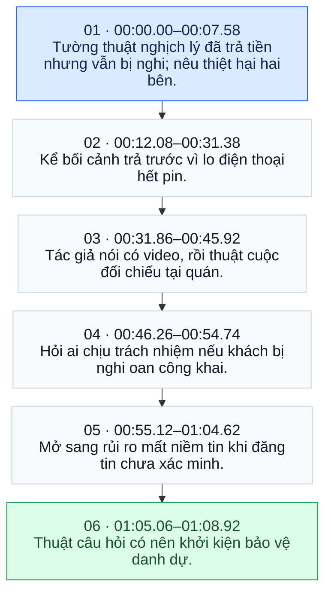

# Nghịch lý danh dự: trả tiền rồi vẫn bị nghi chưa trả

[Video gốc — @kienthuckinhte28](https://www.tiktok.com/@kienthuckinhte28/video/7706772856650239233) · ID `7706772856650239233`

**Tóm tắt cách kể:** Nghịch lý đạo đức dễ hiểu → lùi về hoàn cảnh dẫn tới hiểu lầm → dẫn lời có chứng cứ → mở vấn đề trách nhiệm và niềm tin. Sức kéo nằm ở lệch nhau giữa việc người kể nói đã làm và cách họ bị công khai đánh giá, khác bài giải thích khái niệm tài chính.

[Sơ đồ diễn biến](#mindmap) · [Diễn biến](#dien-bien) · [Nhịp cảm xúc](#cam-xuc) · [Cách áp dụng](#ap-dung)

## Sơ đồ diễn biến

Đọc từ trên xuống: mỗi hộp là một nhịp theo mốc ASR hoặc khung hình được ghi trong phân tích. Xanh dương là mở đầu, xanh lá là nhịp cuối. Chi tiết và giới hạn nằm trong phân tích bên dưới.

[Mã Mermaid riêng](../mindmaps/7706772856650239233.mmd)

## Dữ liệu và nguồn

**Cách thể hiện:** Bản tin ngắn trên ảnh và tư liệu

**Phạm vi học:** Xem phạm vi kiểm và giới hạn từng ca.

**Ngữ cảnh thương mại:** Chưa xác nhận hợp tác thương mại; xem các đoạn tự quảng bá/giới hạn được ghi riêng.

- Đăng: 2026-11-11T05:15:00+00:00. Metadata lấy: 2026-11-15T04:04:09.915350+00:00.
- **1,500,000 view**; thích 65,200; bình luận 768; chia sẻ 5,038; lưu 1,474. Dấu phẩy tách hàng nghìn.
- Thời lượng media: 74.68s.
- **82.42× P50** 18,200 của 79 bài đủ 48h trong snapshot kênh. Clip có trong cửa sổ baseline. Không phải thống kê toàn bộ kênh.

## Phạm vi kiểm

Đã tải media, xem khung chọn lọc và đọc ASR có mốc lưu lúc 2026-11-15T04:06:46.808789+00:00. Đối chiếu cùng ID và thời lượng, lệch 0.025s. **Chưa nghe toàn âm hoặc xem chuyển động liên tục; chưa xác nhận toàn văn ASR hay mọi dữ kiện trong clip.**

Media SHA256: `8bc03701990a037464eff515386b8a8d9ccb0e44dbe46cd806a93f1f46cef6e3`. [Metadata và các hash khác](../videos.json). Video/ASR đầy đủ giữ ở bộ nghiên cứu cục bộ; bản chia sẻ giữ link gốc, trích ngắn và phân tích riêng.

## Lời hứa và câu hỏi trung tâm

**Lời hứa:** Giải thích vì sao một giao dịch được kể là đã hoàn tất lại thành tranh cãi công khai và tổn hại niềm tin.

**Câu hỏi:** Một sai lệch đối soát bị đưa lên mạng có thể chuyển thành tổn hại danh dự như thế nào?

## Mở đầu: lời và hình

ASR 0–3,28 giây đặt hai việc trái kỳ vọng cạnh nhau: đã thanh toán nhưng vẫn bị nghi không trả. 3,64–7,58 giây nâng hệ quả sang danh dự khách và uy tín quán. Các khung đầu có cảnh camera và tiêu đề; ảnh bài đăng được thêm vào khung 2–5 giây. Đây là xung đột quy trình dịch vụ qua một vụ được kể lại, chưa phải sự việc đã được người phân tích kiểm chứng.

> Đã thanh toán tiền ăn nhưng vẫn bị đăng lên fanpage nghi quỳt tiền.

Trích ASR ngắn từ segment 00:00.00–00:03.28. Trích ASR chưa nghe đối chiếu; dữ kiện thuộc lời người đăng, chưa xác thực. Xem giới hạn từng ca. Dấu … nghĩa là bỏ bớt, không khẳng định toàn câu vừa ba giây.

| Mốc khung đã xem | Điều quan sát được |
|---|---|
| 00:00.00 | Cảnh camera nhìn xuống khu bàn và quầy; khối tiêu đề đỏ chiếm phần dưới. |
| 00:02.00 | Ảnh chụp một bài đăng mạng xã hội được ghép lên cảnh camera. |
| 00:22.40 | Cảnh camera cho thấy một người đứng ở quầy, bố cục có phần nền làm mờ. |
| 00:33.60 | Một khung camera khác vẫn ở quầy; không đủ để xác nhận giao dịch chỉ qua ảnh tĩnh. |
| 00:56.01 | Ảnh bài đăng có nhiều ảnh nhỏ camera, dùng như chất liệu của câu chuyện. |
| 01:13.68 | Hồ sơ kênh xuất hiện sau phần ASR đặt câu hỏi cuối. |

Không suy chuyển động giữa các khung từ ảnh tĩnh.

## Diễn biến và nhiệm vụ từng beat

| Mốc ASR | Diễn giải riêng | Vai trò |
|---|---|---|
| 00:00.00–00:07.58 | Tường thuật nghịch lý đã trả tiền nhưng vẫn bị nghi; nêu thiệt hại hai bên. | Hook bất công và hậu quả danh dự. |
| 00:12.08–00:31.38 | Kể bối cảnh trả trước vì lo điện thoại hết pin. | Lùi lại nguyên nhân theo lời người thân được dẫn. |
| 00:31.86–00:45.92 | Tác giả nói có video, rồi thuật cuộc đối chiếu tại quán. | Đưa lời khẳng định có chứng cứ và phản ứng; chưa kiểm chứng độc lập. |
| 00:46.26–00:54.74 | Hỏi ai chịu trách nhiệm nếu khách bị nghi oan công khai. | Chuyển vụ riêng thành vấn đề trách nhiệm. |
| 00:55.12–01:04.62 | Mở sang rủi ro mất niềm tin khi đăng tin chưa xác minh. | Chốt bài học quy trình dịch vụ. |
| 01:05.06–01:08.92 | Thuật câu hỏi có nên khởi kiện bảo vệ danh dự. | Kết mở để khán giả cân nhắc; không có kết luận pháp lý. |

## Nhịp cảm xúc — giả thuyết biên tập

Các trạng thái dưới đây là cách đọc câu chuyện từ bằng chứng, không phải cảm xúc người xem đã đo hoặc biểu đồ retention.

| Mốc | Cảm xúc có thể gợi | Bằng chứng | Cách diễn giải |
|---|---|---|---|
| 00:00.00–00:07.58 | Bức xúc có điều kiện | Mở bằng tương phản đã trả với bị nghi, kèm thiệt hại danh dự. | Người xem được mời đứng trước một tình huống bất công theo lời kể. |
| 00:12.08–00:31.38 | Hiểu hoàn cảnh | Lý do điện thoại và trả trước được thuật lại. | Biến nhân vật từ nhãn trong tin thành người có lý do hành động. |
| 00:31.86–00:45.92 | Chờ đối chiếu | Nguồn nói có video và cuộc gặp tại quán. | Tạo kỳ vọng giải quyết, chưa xác nhận nội dung bằng chứng. |
| 00:46.26–01:08.92 | Cân nhắc trách nhiệm | Câu hỏi danh dự rồi niềm tin và khởi kiện. | Đẩy từ theo dõi sự cố sang phán đoán chuẩn ứng xử; cần giữ tính có điều kiện. |

## Cách phân phối thông tin

| Mốc | Động tác viết | Vì sao đáng chú ý |
|---|---|---|
| 00:00.00–00:07.58 | Kết quả bất thường trước bối cảnh | Giúp người xem hiểu xung đột mà không cần tên người hay địa chỉ. |
| 00:12.08–00:45.92 | Lùi thời gian rồi tiến đến đối chiếu | Tạo chuỗi nguyên nhân thay vì chỉ lặp cáo buộc. |
| 00:46.26–01:04.62 | Mở từ vụ riêng sang quy trình | Bài học nằm ở xác minh trước khi công khai. |
| 01:05.06–01:08.92 | Câu hỏi chưa có kết quả | Mở thảo luận nhưng không cung cấp phán quyết. |

## Giải đáp và cách kết

Lời kết là câu hỏi về khả năng khởi kiện, không có kết quả giải quyết tranh chấp. Khung cuối chuyển sang hồ sơ kênh; không gọi đây là phán quyết hay kết luận trách nhiệm.

## Điểm mạnh có dẫn chứng

- **Xung đột hiểu nhanh** — 0–3,28 giây một giao dịch hoàn tất đối lập với nghi vấn chưa thanh toán.

- **Hai bên đều có cái mất** — 3,64–7,58 giây đặt danh dự khách cạnh uy tín quán.

- **Bối cảnh có chức năng nhân quả** — 26,7–31,38 giây lý do trả trước làm rõ điểm dễ lệch đối soát.

## Điểm yếu và điều không nên bắt chước

- **Lời kể có thể dẫn khán giả kết tội sớm** — Hook nêu đã thanh toán ở dạng khẳng định trước khi dẫn nguồn 12,08 giây.

- **Chưa có kết quả kiểm chứng hay giải quyết** — 65,06–68,92 giây kết ở câu hỏi khởi kiện.

- **Chất liệu camera dễ bị nhầm thành bằng chứng đầy đủ** — Các khung mẫu chỉ cho thấy sự hiện diện ở quầy, không đủ xác nhận toàn giao dịch.

## Khả năng được chia sẻ — chưa kiểm chứng

Không có dữ liệu phân phối/retention để kết luận vì sao viral. Các ý sau chỉ là giả thuyết để thử:

- Tình huống trả tiền và bị hiểu lầm có thể gợi người xem gửi cho người làm dịch vụ để bàn quy trình đối soát.

- Câu hỏi danh dự có thể kéo ý kiến trái chiều; chưa có phân tích bình luận để biết điều này xảy ra hay không.

## Chuyển cơ chế sang bài mới

Có thể học cách mở một sai lệch kỳ vọng, kể lại trình tự rồi rút câu hỏi quy trình. Khi dùng vụ thật, phải phân biệt lời bên liên quan với sự thật xác minh, ẩn danh khi không cần định danh và tránh dùng câu hỏi cuối để ngầm kết tội.

- Gắn nguồn và mức xác minh vào ngay câu mở khi thuật vụ đang tranh cãi.

- Giữ ba lớp riêng: lời kể, tài liệu nhìn thấy, kết luận đã xác minh.

- Rút bài học đối soát và xác minh thông tin; không khuyến khích công kích người trong vụ.

- Câu hỏi thảo luận nên xoay vào quy trình, không yêu cầu khán giả phán án.

Không dùng bài chuyển thể chưa được người dùng duyệt làm mẫu giọng lâu dài.

## Giới hạn còn lại

- Phân tích dựa trên toàn bộ ASR có timestamp và 12 khung hình lấy mẫu từ bản tải mới; chưa nghe âm hoặc xem video liên tục.

- Cảm xúc, khả năng chia sẻ và giữ chân là giả thuyết biên tập; không có retention hay thử nghiệm nhân quả.

- Thông tin là tường thuật của kênh dẫn lời bên liên quan; chưa đối chiếu bài gốc, camera đầy đủ hay phản hồi độc lập.

- Không xác nhận cáo buộc, định danh quán/cá nhân hoặc kết luận pháp lý. Ảnh camera tĩnh không chứng minh đủ việc thanh toán.
