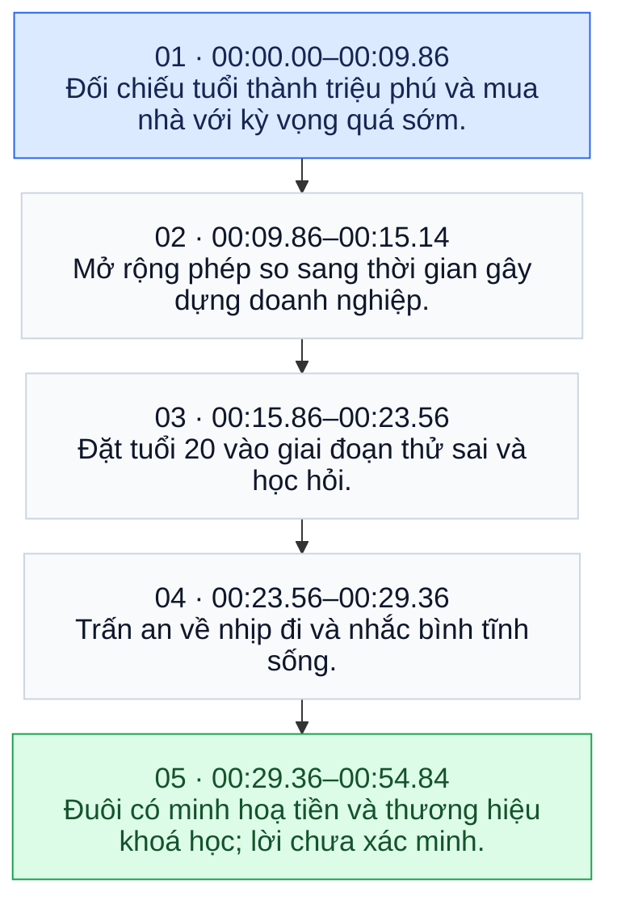

# Chậm hơn hình dung không đồng nghĩa trễ cuộc đời

[Video gốc — @thayqueo](https://www.tiktok.com/@thayqueo/video/7707191277405736193) · ID `7707191277405736193`

**Tóm tắt cách kể:** Đưa một mốc so sánh bị kỳ vọng quá sớm → thay mốc → mở rộng qua vài thành tựu → trả tuổi trẻ về giai đoạn học hỏi → trấn an. Đây là cơ chế điều chỉnh chuẩn so sánh, không chứng minh các tuổi trung bình nêu ra đúng với người xem Việt Nam.

[Sơ đồ diễn biến](#mindmap) · [Diễn biến](#dien-bien) · [Nhịp cảm xúc](#cam-xuc) · [Cách áp dụng](#ap-dung)

## Sơ đồ diễn biến

Đọc từ trên xuống: mỗi hộp là một nhịp theo mốc ASR hoặc khung hình được ghi trong phân tích. Xanh dương là mở đầu, xanh lá là nhịp cuối. Chi tiết và giới hạn nằm trong phân tích bên dưới.

[Mã Mermaid riêng](../mindmaps/7707191277405736193.mmd)

## Dữ liệu và nguồn

**Cách thể hiện:** Người dẫn nói trực diện

**Ngữ cảnh thương mại:** Chưa xác nhận hợp tác thương mại; xem các đoạn tự quảng bá/giới hạn được ghi riêng.

- Đăng: 2026-11-12T13:00:00+00:00. Metadata lấy: 2026-11-15T04:03:53.524358+00:00.
- **317,000 view**; thích 29,100; bình luận 144; chia sẻ 6,236; lưu 2,460. Dấu phẩy tách hàng nghìn.
- Thời lượng media: 55.84s.
- **14.95× P50** 21,200 của 147 bài đủ 48h trong snapshot kênh. Clip có trong cửa sổ baseline. Không phải thống kê toàn bộ kênh.

## Phạm vi kiểm

Đã tải media, xem khung chọn lọc và đọc ASR có mốc lưu lúc 2026-11-15T04:05:13.212624+00:00. Đối chiếu cùng ID và thời lượng, lệch 0.001s. **Chưa nghe toàn âm hoặc xem chuyển động liên tục; chưa xác nhận toàn văn ASR hay mọi dữ kiện kinh tế trong clip.**

Media SHA256: `532a01e77cfa3b4ce726b8f48bdcdb31e22496224ac7f4a3f1d8fdab6515cd09`. [Metadata và các hash khác](../videos.json). Video/ASR đầy đủ giữ ở bộ nghiên cứu cục bộ; bản chia sẻ giữ link gốc, trích ngắn và phân tích riêng.

## Lời hứa và câu hỏi trung tâm

**Lời hứa:** Gỡ cảm giác tụt lại bằng việc xem lại thời hạn tưởng tượng cho thành tựu.

**Câu hỏi:** Bạn thực sự trễ hay đang dùng một mốc thành công quá sớm để tự đánh giá?

## Mở đầu: lời và hình

Khung đầu đen; từ 1 giây thấy người mặc áo đỏ sẫm. ASR mở bằng đối chiếu tuổi trở thành triệu phú với tuổi 21, rồi tuổi mua căn nhà đầu với 23. Hình 5 và 8,38 giây nhấn chữ vàng ở hai phía đối chiếu; hook dùng chuẩn tuổi được điều chỉnh để gỡ cảm giác thua kém.

> Tuổi trung bình đã trở thành triệu phú là 57 tuổi, không phải là 21

Trích ASR ngắn từ segment 00:00.00–00:05.36. Trích ASR chưa nghe đối chiếu; dữ kiện thuộc lời người đăng, chưa xác thực. Xem giới hạn từng ca. Dấu … nghĩa là bỏ bớt, không khẳng định toàn câu vừa ba giây.

| Mốc khung đã xem | Điều quan sát được |
|---|---|
| 00:00.00 | Khung đen ở thời điểm mẫu 0 giây. |
| 00:02.00 | Người nói ở trung cảnh, phụ đề trắng đề cập tuổi trung bình thành triệu phú. |
| 00:05.00 | Cận người nói, một ngón tay đưa lên; phụ đề vàng nhấn vế không phải 21. |
| 00:08.38 | Phụ đề vàng nhấn tuổi 38; nền và người nói không đổi. |
| 00:16.75 | Trung cảnh và phụ đề trắng về những năm tuổi 20. |
| 00:25.13 | Cận người nói, phụ đề trấn an rằng người xem không hề muộn. |
| 00:41.88 | Minh hoạ hoạt hình chi tiêu và số dư, khác hẳn phần người nói. |
| 00:50.26 | Khung hoạt hình có nhãn INTELLIGENT MONEY; chứng cứ hình cho đuôi quảng bá, không xác nhận lời CTA. |

Không suy chuyển động giữa các khung từ ảnh tĩnh.

## Diễn biến và nhiệm vụ từng beat

| Mốc ASR | Diễn giải riêng | Vai trò |
|---|---|---|
| 00:00.00–00:09.86 | Đối chiếu tuổi thành triệu phú và mua nhà với kỳ vọng quá sớm. | Dùng chênh lệch chuẩn tuổi để phản bác cảm giác chậm. |
| 00:09.86–00:15.14 | Mở rộng phép so sang thời gian gây dựng doanh nghiệp. | Cho thấy cùng một cách nhìn ở mục tiêu khác. |
| 00:15.86–00:23.56 | Đặt tuổi 20 vào giai đoạn thử sai và học hỏi. | Thay tiêu chuẩn hoàn thiện bằng chức năng của giai đoạn. |
| 00:23.56–00:29.36 | Trấn an về nhịp đi và nhắc bình tĩnh sống. | Khép thông điệp động viên. |
| 00:29.36–00:54.84 | Đuôi có minh hoạ tiền và thương hiệu khoá học; lời chưa xác minh. | Ghi nhận chuyển sang quảng bá qua ảnh, không dùng ASR lỗi để suy ra nội dung. |

## Nhịp cảm xúc — giả thuyết biên tập

Các trạng thái dưới đây là cách đọc câu chuyện từ bằng chứng, không phải cảm xúc người xem đã đo hoặc biểu đồ retention.

| Mốc | Cảm xúc có thể gợi | Bằng chứng | Cách diễn giải |
|---|---|---|---|
| 00:00.00–00:09.86 | Ngạc nhiên với chuẩn tuổi | Hai phép đối chiếu thành tựu và tuổi được đưa ngay mở. | Chênh lệch số gợi một lời phản biện với áp lực, nhưng chất lượng dữ kiện còn thiếu. |
| 00:09.86–00:23.56 | Cách hiểu bớt khắt khe | Từ doanh nghiệp nhiều năm sang tuổi 20 để học và thử sai. | Mở rộng lập luận trước khi cá nhân hoá lời trấn an. |
| 00:23.56–00:29.36 | Được trấn an | Lời kết nhấn nhịp riêng và bình tĩnh. | Đây là cảm xúc mà câu chữ hướng tới, không phải phản ứng người xem đã đo. |
| 00:29.36–00:54.84 | Chuyển ngữ cảnh thương mại | Khung 41,88 và 50,26 giây là minh hoạ tài chính và thương hiệu. | Không suy ra được diễn biến cảm xúc qua phần lời ASR hỏng. |

## Cách phân phối thông tin

| Mốc | Động tác viết | Vì sao đáng chú ý |
|---|---|---|
| 00:00.00–00:09.86 | Cặp số tương phản | Làm chênh lệch chuẩn nhìn thấy qua phụ đề nhấn màu. |
| 00:09.86–00:15.14 | Thêm một lĩnh vực | Cho luận điểm phạm vi rộng hơn chuyện tuổi mua nhà. |
| 00:15.86–00:29.36 | Đổi thước đo rồi trấn an | Không dừng ở việc bảo người xem đừng lo; đưa chức năng học hỏi cho tuổi trẻ. |
| 00:29.36–00:54.84 | Đuôi minh hoạ thương hiệu | Cần phân biệt cơ chế nội dung với mục tiêu quảng bá và vùng thiếu lời đáng tin. |

## Giải đáp và cách kết

Thông điệp trấn an khép ở 29,36 giây theo phần ASR có căn cứ. Sau đó các ảnh 41,88 và 50,26 giây cho thấy minh hoạ chi tiêu và INTELLIGENT MONEY, tức có đuôi quảng bá bằng hình. Không xác nhận được lời nói của đuôi.

## Điểm mạnh có dẫn chứng

- **Phép so nhận ra nhanh** — 0–9,86 giây chỉ dùng tuổi và thành tựu; khung 5 và 8,38 giây nhấn vế so sánh màu vàng.

- **Có ý kết rõ trước đuôi thương mại** — 23,56–29,36 giây trả lại thông điệp nhịp đi cá nhân.

## Điểm yếu và điều không nên bắt chước

- **Mốc tuổi thiếu bối cảnh** — 0–9,86 giây không có nguồn hay địa bàn cho hai số trung bình trong ASR.

- **Phần đuôi không thể phân tích lời chính xác** — ASR 29,36–51,86 giây đáng ngờ; chỉ có bằng chứng hình cho quảng bá.

- **Giải toả chưa chuyển thành kế hoạch** — Phần có lời đáng tin không đưa hành động cụ thể để xử lý khó khăn tài chính.

## Khả năng được chia sẻ — chưa kiểm chứng

Không có dữ liệu phân phối/retention để kết luận vì sao viral. Các ý sau chỉ là giả thuyết để thử:

- Người trẻ có thể gửi lời trấn an ngắn cho bạn bè đang so sánh tiến độ; chưa có số liệu xác nhận.

- Cặp số ngắn dễ được nhớ hoặc trích lại, cũng làm nguy cơ lan số thiếu nguồn cao hơn.

## Chuyển cơ chế sang bài mới

Có thể học cấu trúc ba vế: điều bị thúc phải đạt, chuẩn có nguồn phù hợp, rồi một cách nhìn giúp hành động. Nếu không có dữ liệu tốt, tránh dùng con số trung bình làm uy tín; thay bằng trường hợp có giới hạn và nêu rõ đối tượng.

- Kiểm tra nguồn, năm và dân số của mọi số trung bình.

- Không áp mốc thành tựu nước ngoài lên khán giả Việt Nam.

- Sau trấn an, thêm một hành động nhỏ phù hợp tình huống nếu mục tiêu là giáo dục.

- Đánh dấu và bỏ ASR lỗi thay vì biến thành CTA.

- Nhận diện đuôi quảng bá bằng bằng chứng quan sát được.

Không dùng bài chuyển thể chưa được người dùng duyệt làm mẫu giọng lâu dài.

## Giới hạn còn lại

- Đã đọc toàn bộ ASR có timestamp và xem 12 khung trích của cùng ID; chưa nghe toàn âm thanh hoặc xem video liên tục.

- Không có retention, tỷ lệ xem hết hay thử nghiệm nhân quả; các nhận định giữ chân và chia sẻ là giả thuyết về cách trình bày.

- Segment ASR 29,36–51,86 giây nhận thành câu subscribe La La School, không khớp bằng chứng hình đã xem; coi là nhận dạng không đáng tin và không dùng làm CTA thật.

- Các tuổi trung bình 57 và 38 không có nguồn, địa bàn hoặc nhóm dân số trong phần ASR; không thể xem là chuẩn tài chính Việt Nam.

- Đuôi quảng bá được xác nhận qua ảnh, nội dung lời và mốc bắt đầu chính xác chưa xác minh.
