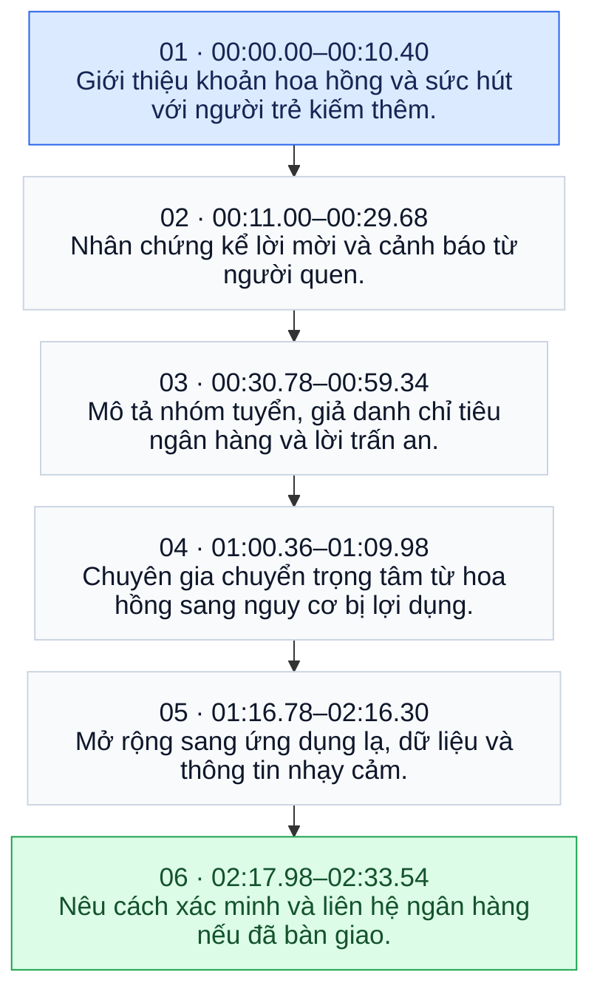

# Hoa hồng mở tài khoản: từ tiền nhỏ đến rủi ro dữ liệu

[Video gốc — @vtv24news](https://www.tiktok.com/@vtv24news/video/7707502256387542293) · ID `7707502256387542293`

**Tóm tắt cách kể:** Lợi ích nhỏ dễ nhận → tình huống người trẻ → lời mời có vẻ hợp lệ → chuyên gia giải thích cái giá ẩn → hành động phòng ngừa và xử lý. Khung chữ cảnh báo lộ ngay đầu nên cơ chế là minh hoạ và giải thích lời cảnh báo, không phải đánh lừa người xem bằng một bất ngờ muộn.

[Sơ đồ diễn biến](#mindmap) · [Diễn biến](#dien-bien) · [Nhịp cảm xúc](#cam-xuc) · [Cách áp dụng](#ap-dung)

## Sơ đồ diễn biến

Đọc từ trên xuống: mỗi hộp là một nhịp theo mốc ASR hoặc khung hình được ghi trong phân tích. Xanh dương là mở đầu, xanh lá là nhịp cuối. Chi tiết và giới hạn nằm trong phân tích bên dưới.

[Mã Mermaid riêng](../mindmaps/7707502256387542293.mmd)

## Dữ liệu và nguồn

**Cách thể hiện:** Phóng sự và giải thích truyền hình

**Phạm vi học:** Xem phạm vi kiểm và giới hạn từng ca.

**Ngữ cảnh thương mại:** Chưa xác nhận hợp tác thương mại; xem các đoạn tự quảng bá/giới hạn được ghi riêng.

- Đăng: 2026-11-13T06:00:00+00:00. Metadata lấy: 2026-11-15T04:03:58.913834+00:00.
- **919,800 view**; thích 8,497; bình luận 0; chia sẻ 9,991; lưu 514. Dấu phẩy tách hàng nghìn.
- Thời lượng media: 154.67s.
- **19.84× P50** 46,350 của 122 bài đủ 48h trong snapshot kênh. Clip có trong cửa sổ baseline. Không phải thống kê toàn bộ kênh.

## Phạm vi kiểm

Đã tải media, xem khung chọn lọc và đọc ASR có mốc lưu lúc 2026-11-15T04:05:40.773282+00:00. Đối chiếu cùng ID và thời lượng, lệch 0.0s. **Chưa nghe toàn âm hoặc xem chuyển động liên tục; chưa xác nhận toàn văn ASR hay mọi dữ kiện trong clip.**

Media SHA256: `079c5b359a0f21c47392cf158093dbf4f3addfd34610b45f848cadd9400bdd21`. [Metadata và các hash khác](../videos.json). Video/ASR đầy đủ giữ ở bộ nghiên cứu cục bộ; bản chia sẻ giữ link gốc, trích ngắn và phân tích riêng.

## Lời hứa và câu hỏi trung tâm

**Lời hứa:** Giúp nhận ra điều kiện ẩn và rủi ro sau lời mời mở tài khoản nhận tiền.

**Câu hỏi:** Vì sao một việc được chào là mở tài khoản lấy hoa hồng có thể khiến người mở chịu hậu quả?

## Mở đầu: lời và hình

ASR mở bằng khoản hoa hồng nhỏ cho mỗi tài khoản và lợi ích khi mở nhiều. Trong khi lời dựng sức hút kiếm thêm, hình 0–5 giây đặt một người trẻ dùng điện thoại trên phố và phần tiêu đề cố định đã nói rõ nguy cơ. Vì vậy đây là tương phản lời mời với cảnh báo có sẵn, không phải cú twist giấu hoàn toàn hiểm hoạ.

> Vài chục đến vài trăm nghìn đồng cho một tài khoản ngân hàng, tăng mời nhiều, tiền công càng tăng.

Trích ASR ngắn từ segment 00:00.00–00:06.94. Trích ASR chưa nghe đối chiếu; dữ kiện thuộc lời người đăng, chưa xác thực. Xem giới hạn từng ca. Dấu … nghĩa là bỏ bớt, không khẳng định toàn câu vừa ba giây.

| Mốc khung đã xem | Điều quan sát được |
|---|---|
| 00:00.00 | Người trẻ đứng trên phố dùng điện thoại; dưới khung tin là tiêu đề cảnh báo về mở tài khoản nhận hoa hồng. |
| 00:05.00 | Cận màn hình điện thoại, khung đỏ và tiêu đề giữ nguyên. |
| 00:23.20 | Phỏng vấn một người trẻ ngoài đường; có thanh tên của bản tin. |
| 00:46.40 | Khung trong phòng với rèm, tương ứng đoạn ASR mô tả lời mời mở tài khoản; ảnh riêng không chứng minh danh tính người mời. |
| 01:09.60 | Cận tay cầm điện thoại, một phần nội dung màn hình được làm mờ. |
| 01:32.80 | Một người được phỏng vấn ở bối cảnh ngoài trời, trang phục áo vest. |
| 01:56.00 | Người được phỏng vấn trước tủ kệ trong phòng, khác nhân vật trước. |
| 02:19.20 | Bối cảnh phòng làm việc với nhiều màn hình và nhân sự; minh hoạ phần khuyến cáo. |

Không suy chuyển động giữa các khung từ ảnh tĩnh.

## Diễn biến và nhiệm vụ từng beat

| Mốc ASR | Diễn giải riêng | Vai trò |
|---|---|---|
| 00:00.00–00:10.40 | Giới thiệu khoản hoa hồng và sức hút với người trẻ kiếm thêm. | Cho thấy vì sao lời mời đáng chú ý trước khi phân tích rủi ro. |
| 00:11.00–00:29.68 | Nhân chứng kể lời mời và cảnh báo từ người quen. | Đặt vấn đề trong tình huống người thật thay vì chỉ giảng giải. |
| 00:30.78–00:59.34 | Mô tả nhóm tuyển, giả danh chỉ tiêu ngân hàng và lời trấn an. | Làm rõ hình thức thuyết phục; không coi lời tự xưng là xác thực. |
| 01:00.36–01:09.98 | Chuyên gia chuyển trọng tâm từ hoa hồng sang nguy cơ bị lợi dụng. | Đổi ý nghĩa của việc cho người khác sử dụng tài khoản. |
| 01:16.78–02:16.30 | Mở rộng sang ứng dụng lạ, dữ liệu và thông tin nhạy cảm. | Giải thích các lớp hậu quả được nguồn cảnh báo. |
| 02:17.98–02:33.54 | Nêu cách xác minh và liên hệ ngân hàng nếu đã bàn giao. | Kết bằng hành động cho cả người chưa làm và đã làm. |

## Nhịp cảm xúc — giả thuyết biên tập

Các trạng thái dưới đây là cách đọc câu chuyện từ bằng chứng, không phải cảm xúc người xem đã đo hoặc biểu đồ retention.

| Mốc | Cảm xúc có thể gợi | Bằng chứng | Cách diễn giải |
|---|---|---|---|
| 00:00.00–00:10.40 | Nhận ra sức hút | Khoản tiền nhỏ và cơ chế nhiều tài khoản được đưa trước. | Đặt người xem vào động cơ kiếm thêm, dù tiêu đề đã cảnh báo. |
| 00:11.00–00:59.34 | Nghi ngờ tăng dần | Nhân chứng và lời mời tự xưng nhân viên ngân hàng nối nhau. | Cụ thể hoá cách một đề nghị được làm có vẻ bình thường. |
| 01:00.36–02:16.30 | Thấy hệ quả lớn hơn | Nguồn chuyên gia nói đến sử dụng tài khoản, ứng dụng và dữ liệu. | Chuyển từ khoản lợi nhỏ sang những thứ người tham gia có thể mất. |
| 02:17.98–02:33.54 | Có hướng xử lý | Khuyến cáo xác minh và liên hệ ngân hàng. | Phần kết hướng cảm giác lo lắng vào hành động thay vì tăng đe doạ. |

## Cách phân phối thông tin

| Mốc | Động tác viết | Vì sao đáng chú ý |
|---|---|---|
| 00:00.00–00:29.68 | Động cơ rồi nhân chứng | Giúp tình huống có người và lợi ích cụ thể. |
| 00:30.78–00:59.34 | Tái hiện logic lời mời | Cho thấy các lời trấn an cần bị xem xét, không chỉ gắn nhãn đáng ngờ. |
| 01:00.36–02:16.30 | Chuyên gia phân lớp rủi ro | Tách tài khoản, ứng dụng và dữ liệu thành các đường hậu quả. |
| 02:17.98–02:33.54 | Đóng bằng hai trạng thái | Người chưa tham gia và đã bàn giao đều có điểm hành động. |

## Giải đáp và cách kết

Khuyến cáo được chia thành kiểm tra trực tiếp với ngân hàng, giữ thông tin bảo mật và liên hệ ngân hàng khi đã giao tài khoản. Phần kết đưa một lối xử lý cụ thể thay cho chỉ để lại nỗi sợ; đây là khuyến cáo của phóng sự, không phải tư vấn pháp lý độc lập.

## Điểm mạnh có dẫn chứng

- **Lời mời được giải thích trước khi phán xét** — 0–10,4 giây cho thấy động cơ kiếm thêm của nhóm người trẻ.

- **Có thay đổi vai bằng chứng** — 11–29,68 giây là lời người được phỏng vấn; 60,36–136,3 giây chuyển sang giải thích chuyên gia.

- **Kết trả lời câu phải làm gì** — 137,98–153,54 giây có bước xác minh và liên hệ ngân hàng.

## Điểm yếu và điều không nên bắt chước

- **Tiêu đề và phần lời chia sự chú ý** — Các ảnh cho thấy hình bản tin nằm nửa trên, khối cảnh báo lớn lặp suốt phía dưới; chưa đo mức đọc hiểu.

- **Khối chuyên gia dài** — 76,78–136,3 giây tập trung thêm nhiều rủi ro; không có retention để đánh giá hiệu quả từng lớp.

- **Nguy cơ đồng nhất các tình huống** — Khuyến cáo chung không chứng minh mọi lời mời mở tài khoản đều là cùng một hành vi sai phạm.

## Khả năng được chia sẻ — chưa kiểm chứng

Không có dữ liệu phân phối/retention để kết luận vì sao viral. Các ý sau chỉ là giả thuyết để thử:

- Cảnh báo có tình huống cụ thể và bước xử lý có thể được gửi cho người đang kiếm việc thêm.

- Người từng gặp lời mời tương tự có thể dùng clip làm điểm mở cuộc trao đổi; chưa đo chia sẻ thực.

## Chuyển cơ chế sang bài mới

Học cách mở bằng động cơ khiến một người có thể đồng ý, rồi chỉ ra điều kiện bị bỏ sót và kết bằng đường xử lý. Với chủ đề khác, phối nhân chứng, mô tả lời mời và chuyên gia theo vai bằng chứng; không dùng danh xưng hay nhạc tin tức để thay kiểm chứng.

- Nêu cả sức hút lẫn điều kiện ẩn của đề nghị.

- Phân biệt lời tự xưng, lời nhân chứng và đánh giá chuyên gia.

- Không quy kết một cá nhân khi chỉ có dấu hiệu hoặc lời kể.

- Chỉ mô tả thao tác ở mức nhận diện rủi ro, không biến thành hướng dẫn thực hiện.

- Kết bằng bước có nguồn cho cả phòng ngừa và xử lý.

Không dùng bài chuyển thể chưa được người dùng duyệt làm mẫu giọng lâu dài.

## Giới hạn còn lại

- Đã đọc toàn bộ ASR có timestamp và xem 12 khung trích của cùng ID; chưa nghe toàn âm thanh hoặc xem video liên tục.

- Không có retention, tỷ lệ xem hết hay thử nghiệm nhân quả; các nhận định giữ chân và chia sẻ là giả thuyết về cách trình bày.

- Phân tích cách trình bày của phóng sự, không xác minh danh tính người tuyển hay việc tài khoản cụ thể được dùng để phạm tội.

- Các rủi ro kỹ thuật và pháp lý được tường thuật theo nguồn, không được kiểm tra độc lập ở đây.

- Một số segment ASR dài nhiều giây; beats là cụm chủ đề có căn cứ, không phải bản đo từng câu hay từng điểm cắt.
