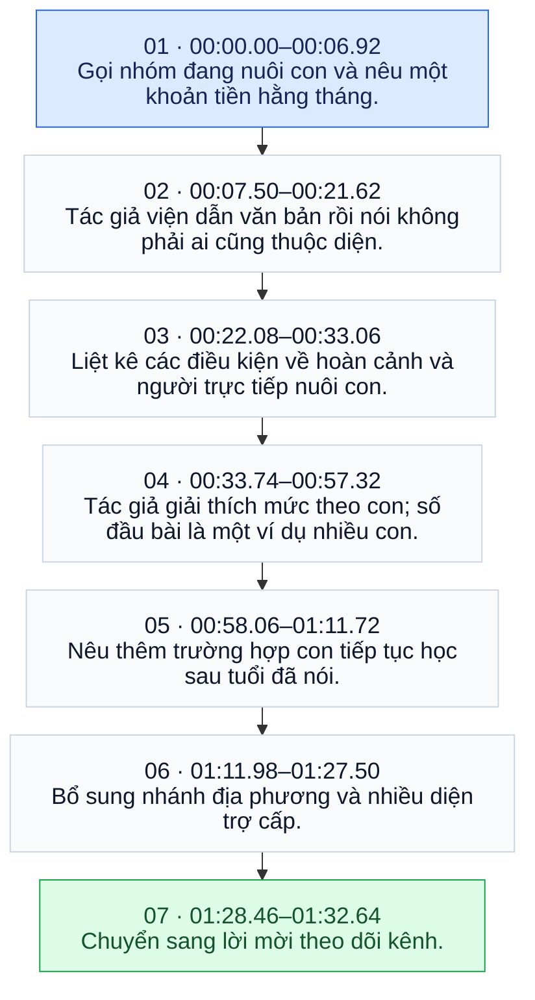

# Quyền lợi có điều kiện: con số lớn rồi mới thu hẹp đối tượng

[Video gốc — @kienthuckinhte28](https://www.tiktok.com/@kienthuckinhte28/video/7707559507609668872) · ID `7707559507609668872`

**Tóm tắt cách kể:** Nhận diện mình thuộc nhóm nào → nhìn thấy lợi ích định lượng → gặp lời chặn không phải ai cũng được → chờ điều kiện và phép tính. Điểm cần phê bình là con số lớn đi trước điều kiện cụ thể khá lâu; không coi đây là kỹ thuật nên sao chép nguyên xi.

[Sơ đồ diễn biến](#mindmap) · [Diễn biến](#dien-bien) · [Nhịp cảm xúc](#cam-xuc) · [Cách áp dụng](#ap-dung)

## Sơ đồ diễn biến

Đọc từ trên xuống: mỗi hộp là một nhịp theo mốc ASR hoặc khung hình được ghi trong phân tích. Xanh dương là mở đầu, xanh lá là nhịp cuối. Chi tiết và giới hạn nằm trong phân tích bên dưới.

[Mã Mermaid riêng](../mindmaps/7707559507609668872.mmd)

## Dữ liệu và nguồn

**Cách thể hiện:** Bản tin ngắn trên ảnh và tư liệu

**Phạm vi học:** Xem phạm vi kiểm và giới hạn từng ca.

**Ngữ cảnh thương mại:** Chưa xác nhận hợp tác thương mại; xem các đoạn tự quảng bá/giới hạn được ghi riêng.

- Đăng: 2026-11-13T08:45:00+00:00. Metadata lấy: 2026-11-15T04:04:08.869199+00:00.
- **1,200,000 view**; thích 26,300; bình luận 1,170; chia sẻ 5,792; lưu 2,494. Dấu phẩy tách hàng nghìn.
- Thời lượng media: 93.27s.
- **65.93× P50** 18,200 của 79 bài đủ 48h trong snapshot kênh. Clip có trong cửa sổ baseline. Không phải thống kê toàn bộ kênh.

## Phạm vi kiểm

Đã tải media, xem khung chọn lọc và đọc ASR có mốc lưu lúc 2026-11-15T04:06:47.193307+00:00. Đối chiếu cùng ID và thời lượng, lệch 0.007s. **Chưa nghe toàn âm hoặc xem chuyển động liên tục; chưa xác nhận toàn văn ASR hay mọi dữ kiện trong clip.**

Media SHA256: `7cce33235aa27dd35d6c70d4b1aace4e8b9862c28f869ff9eb496815b2be2aaa`. [Metadata và các hash khác](../videos.json). Video/ASR đầy đủ giữ ở bộ nghiên cứu cục bộ; bản chia sẻ giữ link gốc, trích ngắn và phân tích riêng.

## Lời hứa và câu hỏi trung tâm

**Lời hứa:** Giúp người xem nhận ra liệu mình có thuộc nhóm mà tác giả nói được hưởng một khoản hỗ trợ hay không.

**Câu hỏi:** Khoản tiền đầu clip ứng với nhóm và điều kiện nào theo lời tác giả?

## Mở đầu: lời và hình

0–6,92 giây ghép người đang nuôi con, khoản tiền cụ thể và mốc thời gian thành câu hỏi ai đủ điều kiện. Khung 0–5 giây đặt tiền cạnh mẹ bế con, tiêu đề chữ trắng trên đỏ. Đây là hook sàng lọc quyền lợi cá nhân, không phải giải thích cơ chế kinh tế bằng linh vật. Số tiền là lời tác giả chưa kiểm chứng; điều kiện tương ứng chỉ được diễn giải về sau.

> Chú ý, đang nuôi con dưới 16 tuổi, ai đủ điều kiện nhận 1.620.000 đồng mỗi tháng từ tháng 10 năm 2026.

Trích ASR ngắn từ segment 00:00.00–00:06.92. Trích ASR chưa nghe đối chiếu; dữ kiện thuộc lời người đăng, chưa xác thực. Xem giới hạn từng ca. Dấu … nghĩa là bỏ bớt, không khẳng định toàn câu vừa ba giây.

| Mốc khung đã xem | Điều quan sát được |
|---|---|
| 00:00.00 | Tay cầm nhiều tờ tiền phía trên, khối đỏ và tiêu đề về khoản trợ cấp phía dưới. |
| 00:01.00 | Ảnh mẹ bế con được ghép vào ảnh tiền; khuôn mặt che mờ. |
| 00:13.99 | Khung chứa ảnh một văn bản trình bày như nghị định; sự xuất hiện không xác nhận tính thật hay hiệu lực. |
| 00:27.98 | Cận tay trẻ em trong tay người lớn, nền trên dưới làm mờ. |
| 00:55.96 | Ảnh đếm tiền tại bàn có máy tính. |
| 01:32.27 | Ảnh trang hồ sơ kênh thay phần minh họa để đỡ lời kêu gọi theo dõi. |

Không suy chuyển động giữa các khung từ ảnh tĩnh.

## Diễn biến và nhiệm vụ từng beat

| Mốc ASR | Diễn giải riêng | Vai trò |
|---|---|---|
| 00:00.00–00:06.92 | Gọi nhóm đang nuôi con và nêu một khoản tiền hằng tháng. | Hook quyền lợi gắn đối tượng; thông tin chưa được kiểm chứng. |
| 00:07.50–00:21.62 | Tác giả viện dẫn văn bản rồi nói không phải ai cũng thuộc diện. | Thu hẹp lời hứa và tạo nhu cầu kiểm tra điều kiện. |
| 00:22.08–00:33.06 | Liệt kê các điều kiện về hoàn cảnh và người trực tiếp nuôi con. | Biến câu hỏi chung thành bước sàng lọc trong lời kể. |
| 00:33.74–00:57.32 | Tác giả giải thích mức theo con; số đầu bài là một ví dụ nhiều con. | Trả lời vì sao tiêu đề có con số đó; chưa xác nhận tính đúng. |
| 00:58.06–01:11.72 | Nêu thêm trường hợp con tiếp tục học sau tuổi đã nói. | Mở nhánh ngoại lệ theo lời tác giả. |
| 01:11.98–01:27.50 | Bổ sung nhánh địa phương và nhiều diện trợ cấp. | Tăng mật độ ngoại lệ, rời câu hỏi đầu. |
| 01:28.46–01:32.64 | Chuyển sang lời mời theo dõi kênh. | CTA sau phần quyền lợi được thuật lại. |

## Nhịp cảm xúc — giả thuyết biên tập

Các trạng thái dưới đây là cách đọc câu chuyện từ bằng chứng, không phải cảm xúc người xem đã đo hoặc biểu đồ retention.

| Mốc | Cảm xúc có thể gợi | Bằng chứng | Cách diễn giải |
|---|---|---|---|
| 00:00.00–00:06.92 | Chú ý vì liên quan gia đình | Nhóm nuôi con và tiền được nêu cùng câu. | Có thể kích hoạt tự đối chiếu hoàn cảnh. |
| 00:18.50–00:33.06 | Thận trọng khi đối chiếu | Lời chặn không phải tất cả rồi liệt kê điều kiện. | Người xem phải sửa kỳ vọng từ tiêu đề. |
| 00:33.74–00:57.32 | Hiểu cách tác giả tạo con số | Số đầu bài được gắn vào ví dụ nhiều con. | Khoảng trống tính toán được đóng, nhưng tính đúng của quy định vẫn chưa xác minh. |
| 00:58.06–01:27.50 | Tải nhận thức tăng | Nhiều nhánh học tập, địa phương và nhiều diện. | Số ngoại lệ có thể làm khó ghi nhớ; chưa có số đo. |

## Cách phân phối thông tin

| Mốc | Động tác viết | Vì sao đáng chú ý |
|---|---|---|
| 00:00.00–00:06.92 | Đối tượng + tiền + thời điểm | Nêu ngay lý do cá nhân để quan tâm. |
| 00:07.50–00:33.06 | Viện dẫn rồi sàng lọc | Tạo cảm giác có căn cứ và thu hẹp nhóm; căn cứ cần xác minh. |
| 00:33.74–00:57.32 | Giải thích đơn vị tính | Cho thấy số nổi bật không phải mức đồng loạt. |
| 00:58.06–01:27.50 | Xếp nhiều ngoại lệ liên tiếp | Mở rộng phạm vi nhưng thiếu cấu trúc phân nhánh nhìn thấy trong các khung mẫu. |

## Giải đáp và cách kết

ASR kết bằng mời theo dõi; khung cuối có hồ sơ kênh. Clip không đưa quy trình kiểm tra văn bản chính thức trong phần lời đã chép.

## Điểm mạnh có dẫn chứng

- **Đối tượng cụ thể ngay đầu** — 0–6,92 giây có nhóm nuôi con, lợi ích định lượng và thời điểm.

- **Có nhịp thu hẹp lời hứa** — 18,5–33,06 giây không tiếp tục hứa cho mọi người.

## Điểm yếu và điều không nên bắt chước

- **Điều kiện của con số tiêu đề trả muộn** — Đến 43,42–57,32 giây mới gắn số đầu bài với ví dụ số con.

- **Độ tin cậy nội dung chưa được thiết lập bằng nguồn kiểm chứng được** — Khung 13,99 giây chỉ là ảnh văn bản; ASR không đưa nguồn truy cập chính thức.

- **Ngoại lệ dồn cuối** — 58,06–87,5 giây chứa nhiều nhánh khác nhau.

## Khả năng được chia sẻ — chưa kiểm chứng

Không có dữ liệu phân phối/retention để kết luận vì sao viral. Các ý sau chỉ là giả thuyết để thử:

- Có thể được gửi trong nhóm gia đình vì người nhận muốn kiểm tra đối tượng, nhưng chưa có dữ liệu đường chia sẻ.

- Con số đầu bài có thể bị tách khỏi điều kiện khi truyền lại; đây là rủi ro cần giảm, không phải mục tiêu biên tập.

## Chuyển cơ chế sang bài mới

Chỉ học cách mở bằng một nhu cầu có đối tượng rồi trả điều kiện rõ. Với quyền lợi pháp lý, phải xác minh nguồn gốc, hiệu lực và nói điều kiện trọng yếu ngay phần mở; không tái sử dụng số liệu ở clip này như sự thật.

- Xác minh văn bản gốc trước khi sử dụng nội dung pháp lý; không coi clip này là căn cứ.

- Đưa điều kiện quyết định cạnh con số ngay đầu; không trì hoãn để tăng tò mò.

- Tách các ngoại lệ thành bảng hoặc câu trả lời riêng thay vì dồn lời.

- Chỉ dùng mẫu cấu trúc quyền lợi có điều kiện, không sao chép mức tiền hoặc chỉ dẫn nhận trợ cấp.

Không dùng bài chuyển thể chưa được người dùng duyệt làm mẫu giọng lâu dài.

## Giới hạn còn lại

- Phân tích dựa trên toàn bộ ASR có timestamp và 12 khung hình lấy mẫu từ bản tải mới; chưa nghe âm hoặc xem video liên tục.

- Cảm xúc, khả năng chia sẻ và giữ chân là giả thuyết biên tập; không có retention hay thử nghiệm nhân quả.

- Nội dung trợ cấp, văn bản, ngày hiệu lực và mức tiền là phát biểu của tác giả, chưa fact-check độc lập. Ảnh văn bản không đủ làm bằng chứng pháp lý.

- ASR có lỗi nhận dạng từ; không dùng để trích quy định hay hướng dẫn nhận tiền.
