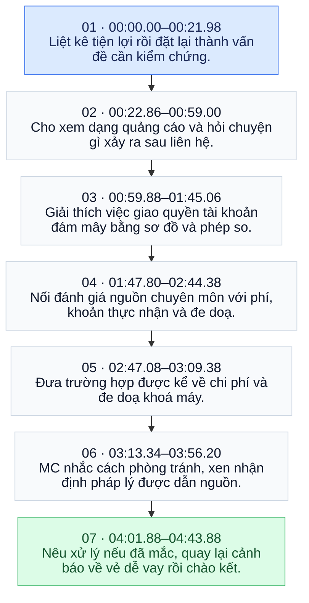

# Vay qua iCloud: tiện lợi ban đầu và quyền kiểm soát bị trao đi

[Video gốc — @vtv24news](https://www.tiktok.com/@vtv24news/video/7708021147719290133) · ID `7708021147719290133`

**Tóm tắt cách kể:** Loại bỏ hàng loạt trở ngại vay trong lời chào → hỏi cái giá bị giấu → dùng sơ đồ giải thích quyền truy cập → đưa hậu quả và lời kể → hướng xử lý → nhắc lại lời chào dưới nghĩa mới. Hook được hỗ trợ bởi một cơ chế giải thích cụ thể, thay vì chỉ gắn nhãn nguy hiểm.

[Sơ đồ diễn biến](#mindmap) · [Diễn biến](#dien-bien) · [Nhịp cảm xúc](#cam-xuc) · [Cách áp dụng](#ap-dung)

## Sơ đồ diễn biến

Đọc từ trên xuống: mỗi hộp là một nhịp theo mốc ASR hoặc khung hình được ghi trong phân tích. Xanh dương là mở đầu, xanh lá là nhịp cuối. Chi tiết và giới hạn nằm trong phân tích bên dưới.

[Mã Mermaid riêng](../mindmaps/7708021147719290133.mmd)

## Dữ liệu và nguồn

**Cách thể hiện:** Phóng sự và giải thích truyền hình

**Phạm vi học:** Xem phạm vi kiểm và giới hạn từng ca.

**Ngữ cảnh thương mại:** Chưa xác nhận hợp tác thương mại; xem các đoạn tự quảng bá/giới hạn được ghi riêng.

- Đăng: 2026-11-15T00:00:00+00:00. Metadata lấy: 2026-11-15T04:04:03.729573+00:00.
- **681,300 view**; thích 9,733; bình luận 0; chia sẻ 4,762; lưu 756. Dấu phẩy tách hàng nghìn.
- Thời lượng media: 290.61s.
- **14.70× P50** 46,350 của 122 bài đủ 48h trong snapshot kênh. Clip có trong cửa sổ baseline. Không phải thống kê toàn bộ kênh.

## Phạm vi kiểm

Đã tải media, xem khung chọn lọc và đọc ASR có mốc lưu lúc 2026-11-15T04:06:32.112087+00:00. Đối chiếu cùng ID và thời lượng, lệch 0.0s. **Chưa nghe toàn âm hoặc xem chuyển động liên tục; chưa xác nhận toàn văn ASR hay mọi dữ kiện trong clip.**

Media SHA256: `e26802d0126faed39e206a92bb981bdfa5c616e3d76728a1c88a3e1ef2953aa8`. [Metadata và các hash khác](../videos.json). Video/ASR đầy đủ giữ ở bộ nghiên cứu cục bộ; bản chia sẻ giữ link gốc, trích ngắn và phân tích riêng.

## Lời hứa và câu hỏi trung tâm

**Lời hứa:** Làm rõ cái giá ẩn của một lời mời vay nhanh thông qua quyền kiểm soát thiết bị và dữ liệu.

**Câu hỏi:** Sự thuận tiện được đổi lấy quyền gì trên điện thoại và cuộc sống số của người vay?

## Mở đầu: lời và hình

ASR liệt kê những trở ngại được bỏ qua khi vay: giấy tờ, thế chấp, gặp mặt, kiểm tra tín dụng, rồi thời gian giải ngân ngắn. Trong hình 0–5 giây MC đứng ở studio kiểm chứng và tiêu đề dưới hình đã báo về cạm bẫy iCloud. Hook đặt tiện lợi cạnh nguy cơ hiện diện bằng chữ, sau đó hứa giải thích cơ chế.

> Thưa quý vị, vay tiền mà không cần phải thế chấp giấy tờ, không gặp mặt, không thẩm định

Trích ASR ngắn từ segment 00:00.00–00:05.30. Trích ASR chưa nghe đối chiếu; dữ kiện thuộc lời người đăng, chưa xác thực. Xem giới hạn từng ca. Dấu … nghĩa là bỏ bớt, không khẳng định toàn câu vừa ba giây.

| Mốc khung đã xem | Điều quan sát được |
|---|---|
| 00:00.00 | MC áo hồng ở studio với bộ chữ chương trình kiểm chứng, dưới là tiêu đề về vay tiền qua iCloud. |
| 00:03.00 | MC ở cỡ gần hơn với một tay đưa trước ngực; khối cảnh báo phía dưới giữ nguyên. |
| 00:43.59 | MC đứng cạnh màn hình có các mẫu quảng cáo vay và một dấu hỏi lớn. |
| 01:27.18 | Màn hình lớn hiển thị iPhone, iCloud và máy chủ nối thành sơ đồ; MC quay sang đồ hoạ. |
| 02:10.78 | Màn hình có ảnh điện thoại và nội dung nhắn, MC đứng bên cạnh. |
| 02:54.37 | Khung tay dùng điện thoại, người phía trước được làm mờ. |
| 03:37.96 | Cận điện thoại có trạng thái liên quan khoá thiết bị, đặt trên nền studio. |
| 04:21.55 | Hình hoạt hoạ một người đưa điện thoại qua bàn; chất liệu khác tư liệu trước. |
| 04:49.61 | Toàn cảnh studio và màn hình chương trình ở đuôi, không thêm lời được ASR xác nhận. |

Không suy chuyển động giữa các khung từ ảnh tĩnh.

## Diễn biến và nhiệm vụ từng beat

| Mốc ASR | Diễn giải riêng | Vai trò |
|---|---|---|
| 00:00.00–00:21.98 | Liệt kê tiện lợi rồi đặt lại thành vấn đề cần kiểm chứng. | Dựng chênh lệch giữa lời chào và điều kiện thật cần tìm hiểu. |
| 00:22.86–00:59.00 | Cho xem dạng quảng cáo và hỏi chuyện gì xảy ra sau liên hệ. | Chuyển từ lời hứa chung sang chuỗi sự việc. |
| 00:59.88–01:45.06 | Giải thích việc giao quyền tài khoản đám mây bằng sơ đồ và phép so. | Đưa cơ chế kiểm soát thiết bị, dữ liệu thành phần trung tâm. |
| 01:47.80–02:44.38 | Nối đánh giá nguồn chuyên môn với phí, khoản thực nhận và đe doạ. | Xếp các hậu quả thành chuỗi từ quyền truy cập tới áp lực tiền. |
| 02:47.08–03:09.38 | Đưa trường hợp được kể về chi phí và đe doạ khoá máy. | Cho hệ quả một lời kể; đoạn ASR chi phí có lặp nên không dùng làm phép tính. |
| 03:13.34–03:56.20 | MC nhắc cách phòng tránh, xen nhận định pháp lý được dẫn nguồn. | Tách thông điệp ứng xử khỏi giải thích kỹ thuật. |
| 04:01.88–04:43.88 | Nêu xử lý nếu đã mắc, quay lại cảnh báo về vẻ dễ vay rồi chào kết. | Đóng vòng lời mời ban đầu và đưa đường hành động. |

## Nhịp cảm xúc — giả thuyết biên tập

Các trạng thái dưới đây là cách đọc câu chuyện từ bằng chứng, không phải cảm xúc người xem đã đo hoặc biểu đồ retention.

| Mốc | Cảm xúc có thể gợi | Bằng chứng | Cách diễn giải |
|---|---|---|---|
| 00:00.00–00:21.98 | Tiện lợi chuyển sang nghi ngờ | Chuỗi không cần điều kiện được nối với cảnh báo cạm bẫy. | Chênh lệch giữa hai cách đóng khung tạo câu hỏi để giải thích. |
| 00:22.86–00:59.00 | Muốn biết bước tiếp | Quảng cáo cụ thể và câu hỏi sau khi liên hệ. | Đặt một chuỗi sự kiện thay cho cảnh báo trừu tượng. |
| 00:59.88–01:45.06 | Hiểu điều bị trao đi | Sơ đồ thiết bị–đám mây–máy chủ và phép so về tài khoản. | Cơ chế quyền truy cập có thể làm nguy cơ dễ hình dung hơn. |
| 01:47.80–03:09.38 | Thấy mức độ nghiêm trọng | Chi phí, đe doạ và lời kể được xếp liên tiếp. | Tăng stakes theo hậu quả được nguồn mô tả; không chứng thực sự việc. |
| 03:13.34–04:43.88 | Có điểm xử lý | Phòng tránh, lưu bằng chứng và nhắc lại lời chào dưới nghĩa khác. | Kết đưa lại quyền hành động cho người xem thay vì chỉ đọng sợ hãi. |

## Cách phân phối thông tin

| Mốc | Động tác viết | Vì sao đáng chú ý |
|---|---|---|
| 00:00.00–00:21.98 | Đối chiếu lời chào và chủ đề kiểm chứng | Cho biết điều cần xem xét từ đầu, không giấu tiêu đề cảnh báo. |
| 00:22.86–00:59.00 | Quảng cáo thành chuỗi câu hỏi | Làm cầu nối từ nhận diện tình huống tới giải thích cơ chế. |
| 00:59.88–01:45.06 | Sơ đồ hoá quan hệ kỹ thuật | Ba thành phần trên màn hình giúp theo dõi quyền kiểm soát theo cách nguồn trình bày. |
| 01:47.80–03:09.38 | Hệ quả nhiều lớp và lời kể | Nối quyền truy cập với tiền, thiết bị, quan hệ và thông tin riêng. |
| 03:13.34–04:43.88 | Phòng ngừa, xử lý, nhắc lại | Kết trả về lời hứa vay dễ, nay được đọc cùng điều kiện ẩn. |

## Giải đáp và cách kết

Đuôi phân biệt phòng ngừa với trường hợp đã gặp rủi ro, khuyên lưu bằng chứng và báo cơ quan có thẩm quyền theo phóng sự. Sau đó quay lại đối chiếu vẻ dễ vay với nguy cơ mất quyền kiểm soát, rồi MC chào kết. Không gọi đây là kết luận pháp lý cho bất kỳ vụ cụ thể nào.

## Điểm mạnh có dẫn chứng

- **Có lời giải cho hook** — 59,88–105,06 giây giải thích quyền tài khoản, hình 87,18 giây có sơ đồ ba thành phần.

- **Nguy cơ được phân thành lớp** — 129,52–164,38 giây lần lượt nói khoản nhận, phí và áp lực khoá máy/theo nguồn.

- **Kết quay lại tiền đề** — 263,96–281,02 giây đối chiếu lại sự dễ dàng ban đầu với nguy cơ được trình bày trong thân bài.

## Điểm yếu và điều không nên bắt chước

- **Dài và nhiều lần nhắc cảnh báo** — 193,34–283,88 giây gồm phòng tránh, pháp lý, xử lý rồi nhắc lại; không có retention để biết nhịp nào cần rút.

- **ASR không đủ tin cho phép tính chi phí** — 167,08–180,4 giây lặp nội dung; cần nghe và kiểm tra nguồn nếu trích số.

- **Hình thức studio không thay kiểm chứng** — Tư liệu và chuyên gia nâng tính cụ thể nhưng không tự chứng minh mọi phát biểu kỹ thuật/pháp lý đúng.

## Khả năng được chia sẻ — chưa kiểm chứng

Không có dữ liệu phân phối/retention để kết luận vì sao viral. Các ý sau chỉ là giả thuyết để thử:

- Cơ chế quyền trên điện thoại có thể khiến người xem gửi clip cho người thân đang thiếu tiền; chưa đo hành vi chia sẻ.

- Sơ đồ và lời kết phòng ngừa có thể giúp clip được dùng như tài liệu cảnh báo, nhưng cần nguồn kỹ thuật cập nhật khi ứng dụng.

## Chuyển cơ chế sang bài mới

Học cách bóc tách một dịch vụ quá thuận tiện bằng câu hỏi người dùng phải trao quyền gì, minh hoạ chuỗi quyền–hệ quả và trở lại lời mở để đóng bài. Mọi nhận định kỹ thuật, lãi suất, pháp lý phải có nguồn riêng phù hợp thời điểm; không lấy video mẫu làm xác nhận độc lập.

- Đặt câu hỏi về thứ người dùng phải trao, không chỉ về thứ họ nhận.

- Vẽ đúng chuỗi quyền và hệ quả có nguồn; tránh hình ẩn dụ làm sai cơ chế.

- Phân biệt quảng cáo, cáo buộc, lời kể và kết luận có thẩm quyền.

- Không sao chép lãi suất hay hình phạt khi chưa kiểm nguồn và thời điểm.

- Cho hướng phòng ngừa và xử lý riêng; đóng bài bằng việc đọc lại lời mở với điều kiện đã được giải thích.

Không dùng bài chuyển thể chưa được người dùng duyệt làm mẫu giọng lâu dài.

## Giới hạn còn lại

- Đã đọc toàn bộ ASR có timestamp và xem 12 khung trích của cùng ID; chưa nghe toàn âm thanh hoặc xem video liên tục.

- Không có retention, tỷ lệ xem hết hay thử nghiệm nhân quả; các nhận định giữ chân và chia sẻ là giả thuyết về cách trình bày.

- Đây là phân tích cấu trúc phóng sự, không xác nhận cáo buộc, tình trạng vi phạm hay kết luận pháp lý đối với các bên trong nguồn.

- ASR 167,08–180,4 giây có lặp nội dung về chi phí và quy đổi; không dùng nó để xác minh con số lãi suất hoặc tái tạo phép tính.

- Các phát biểu về khả năng kiểm soát iCloud, đồng bộ và dữ liệu là mô tả của nguồn, chưa được kiểm chứng kỹ thuật độc lập.

- ASR chào kết dừng 283,88 giây; khung studio cuối 289,61 giây chỉ hỗ trợ mô tả hình đuôi.
